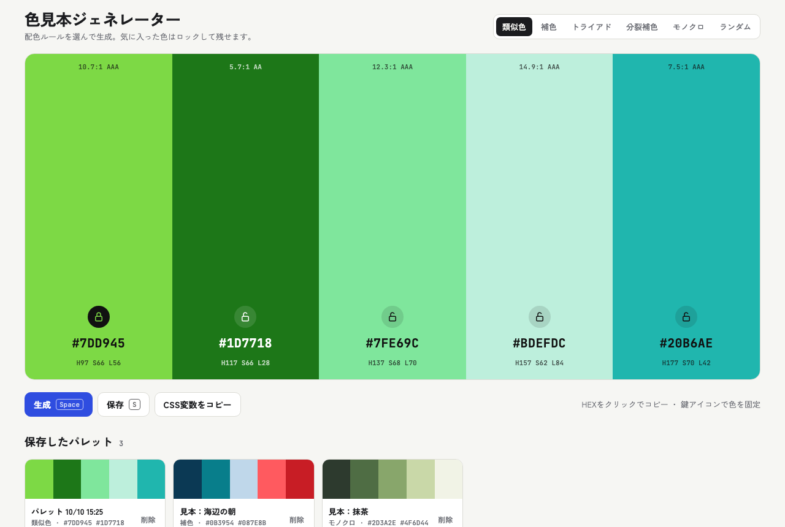

# 色見本ジェネレーター（Colour Palette Generator）

配色ルールを選んで、5色のカラーパレットを作れる Web ツールです。
HTML・CSS・JavaScript だけで作っていて、ビルドも依存ライブラリもありません。



**デモ：** https://kiki-portfolio.kiki-works.workers.dev/color-generator
（ポートフォリオ内のページです。このリポジトリの `index.html` は、ブラウザで直接開いても動きます）

## できること

- 配色ルールを6種類から選んで、5色を生成（類似色・補色・トライアド・分裂補色・モノクロ・ランダム）
- 気に入った色は鍵アイコンで固定し、ほかの色だけを作り直す
- HEX をクリックしてコピー、5色を CSS 変数（`--color-1` 〜 `--color-5`）としてコピー
- 文字とのコントラスト比を表示（WCAG の AA / AAA の目安つき）
- パレットの保存・名前の変更・読み込み・削除（このブラウザの中だけに保存）
- ダークモード対応、スマホ表示対応
- キーボード操作：`Space` で生成、`S` で保存

## 使い方

ビルドは不要です。`index.html` をブラウザで開くだけで動きます。

```bash
open index.html
```

（フォントは Google Fonts から読み込むので、オフラインだと代わりのフォントで表示されます）

## 仕組みと工夫したところ

### 配色ルール（HSL で色相をずらす）

色を HSL（色相・彩度・明度）で作り、基準になる色相から、ルールごとに決まった角度だけずらして5色を作ります。

| ルール | 基準からの色相のずれ |
| --- | --- |
| 類似色 | −40° / −20° / 0° / +20° / +40° |
| 補色 | 0° と 180° を混ぜる（±8° のゆらぎつき） |
| トライアド | 0° / 120° / 240° |
| 分裂補色 | 0° / 150° / 210° |
| モノクロ | 色相は同じで、明度だけ変える |

明度の並びは毎回シャッフルして、同じルールでも単調にならないようにしています。
「鍵で固定した色」があるときは、その色の色相を基準にして、残りの色を作り直します。

### 文字色の自動判定（コントラスト比）

色の上に重ねる文字は、WCAG の計算式で**相対輝度**を求め、黒と白のうちコントラスト比が高いほうを選びます。
どんな色でも、HEX の文字が読めるようにするためです。比の値（例：`7.0:1 AAA`）も、色の上部に表示しています。

### 壊れにくくする工夫

- `localStorage` が使えない環境（プライベートモードなど）でも、`try/catch` で止まらないようにした。保存できないときは、その旨をお知らせする
- パレットの名前を HTML に入れるときは、記号を置きかえて（エスケープ）、変な文字を入れられても崩れないようにした
- 削除は 2 回押して確定する（まちがえて消さないため）
- 名前の変更で、日本語の変換中の `Enter` を確定として扱わない（`isComposing` の確認）

### アクセシビリティ

- すべての操作をボタン（`<button>`）にして、キーボードだけで使えるようにした
- 鍵ボタンの状態を `aria-pressed` で、色の更新を `aria-live` で伝える
- `prefers-reduced-motion` のときは、色の切りかわりのアニメーションを止める
- ボタンを操作しているときは `Space` が生成に取られないようにした（ふつうの「押す」操作を優先）

### フレームワークなしにした理由

小さなツールなので、依存を増やさず、1ファイルで読んで・直して・配れる形にしました。
描画は、状態（`colors` / `locked` / `saved`）から HTML を作り直す、シンプルな作りです。

## 使っている技術

- HTML / CSS（CSS 変数、`color-mix()`、`clamp()`、`prefers-color-scheme`）
- JavaScript（標準の機能のみ。Clipboard API、`localStorage`）
- Google Fonts（Zen Kaku Gothic New / JetBrains Mono / Bricolage Grotesque）

## ファイル

| ファイル | 内容 |
| --- | --- |
| `index.html` | ツール本体（HTML・CSS・JavaScript が1つに入っている） |
| `docs/screenshot.png` | README 用のスクリーンショット |
| `LICENSE` | ライセンス（MIT） |

## 作った人

KIKI — ポートフォリオ：https://kiki-portfolio.kiki-works.workers.dev/

## ライセンス

コードは [MIT](LICENSE) です。
